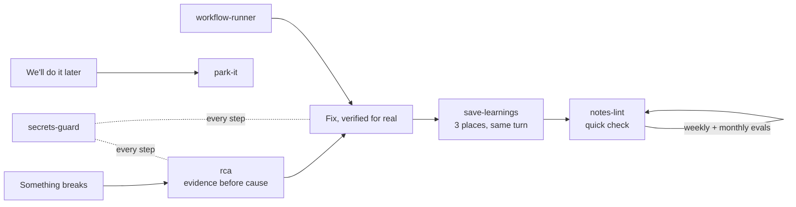

 
 

<p align="center">
  <picture>
    <source media="(prefers-color-scheme: dark)" srcset="images/hero-dark.svg" />
    
  </picture>
</p>

# Claude Code skills I use every day

A **skill** is a folder with a `SKILL.md`: instructions Claude Code loads only when your request matches its description. It's how you turn "the way I like this done" into something Claude does the same way every time.

My motive: I run datacentre operations with Claude Code every day and built a set of skills for it. The work versions are full of internal names, so they can't be shared. **These are generic versions, rewritten from scratch,** with the same ideas: evidence before answers, every fix saved, notes that check themselves, and secrets the AI never sees.

| Skill | What it does | Try saying |
|---|---|---|
| [`linkedin-post`](skills/linkedin-post/) | Drafts LinkedIn posts in your voice from your real facts only, then runs an evidence-graded reach check and an AI-tell checker script | "write a linkedin post about …" |
| [`rca`](skills/rca/) | Root cause analysis: exact symptom → timeline from logs → compare with healthy → one hypothesis at a time → confidence label → RCA in a fixed format | "why did this fail?", "RCA" |
| [`save-learnings`](skills/save-learnings/) | Every verified fix written to three places in the same turn (Claude's memory, the team doc, a local mirror), then lint-checked | "save it", "add to the runbook" |
| [`notes-lint`](skills/notes-lint/) | Health check for your notes: leaked secrets, retired methods, dead links and paths, index limits. Reports first, fixes after a yes | "lint the notes" |
| [`park-it`](skills/park-it/) | "We'll do it later" becomes a to-do item automatically, with what's already known. Reminds at most twice a week | "park it", "what's on my list?" |
| [`secrets-guard`](skills/secrets-guard/) | Secrets in the keychain, added by you in a hidden prompt, read by scripts at runtime. Untrusted text stays data. Weekly read-only Mac check | "is this safe?", "add a token for …" |
| [`workflow-runner`](skills/workflow-runner/) | Raise, rerun and check GitHub Actions with `gh`: inputs passed explicitly and checked, the full run link every time | "run the deploy workflow" |

## How they work together



## Install

```bash
git clone https://github.com/Parag-S-Salunkhe/claude-code-skills
mkdir -p ~/.claude/skills
cp -R claude-code-skills/skills/rca ~/.claude/skills/        # pick the ones you want
```

Skills in `~/.claude/skills/` work in every project. To share one with a team, put it in the repo's `.claude/skills/` instead. Restart Claude Code (or start a new session) and it picks them up.

- `linkedin-post`: copy `templates/*.md` to `~/Documents/LinkedIn/` and fill in your voice profile and stories.
- `park-it`: the list goes to `~/Documents/todo.md` (or set `PARK_IT_FILE`).
- `notes-lint`: point it at your notes (`NOTES_DIRS=dir1:dir2`).

## The guide

[Writing skills that work](docs/Writing-Skills-That-Work.md): what I learned building them, the do's and don'ts

[Keeping skills current](docs/Keeping-Skills-Current.md): evals, smaller models, every miss becomes a test

[Questions & Answers](docs/Questions-and-Answers.md)

Everything here is plain markdown plus small Python and shell scripts (standard library only, no network). Read a skill before you install it: it's instructions your AI will follow.
