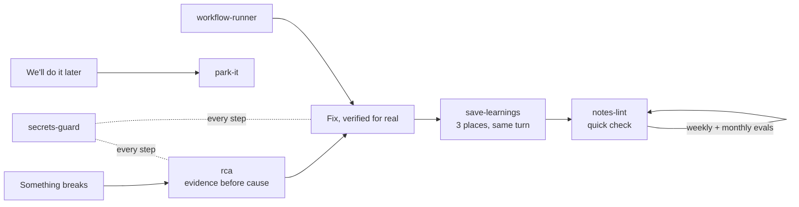

 
 

<p align="center">
  <picture>
    <source media="(prefers-color-scheme: dark)" srcset="images/hero-dark.svg" />
    
  </picture>
</p>

# Claude Code skills I use every day

A **skill** is a folder with a `SKILL.md`: instructions Claude Code loads only when your request matches its description. It's how you turn "the way I like this done" into something Claude does the same way every time.

My motive: I run datacentre operations with Claude Code every day and built a set of skills for it. **These are the ones anyone can use,** built on the same ideas: evidence before answers, every fix saved, notes that check themselves, and secrets the AI never sees.

**Built on other people's ideas.** Nothing here was installed from someone else, but a lot of it started as someone else's idea: obra/superpowers, Anthropic's skill-creator, Karpathy's LLM Wiki and nine open LinkedIn and writing skills. Each one is credited [below](#built-on-other-peoples-ideas), with the reasons I wrote my own instead of installing theirs.

| Skill | What it does | Try saying |
|---|---|---|
| [`linkedin-post`](skills/linkedin-post/) | Drafts LinkedIn posts in your voice from your real facts only, then runs an evidence-graded reach check and an AI-tell checker script | "write a linkedin post about …" |
| [`rca`](skills/rca/) | Root cause analysis: exact symptom → timeline from logs → compare with healthy → one hypothesis at a time → confidence label → RCA in a fixed format | "why did this fail?", "RCA" |
| [`save-learnings`](skills/save-learnings/) | Every verified fix written to three places in the same turn (Claude's memory, the team doc, a local mirror), then lint-checked | "save it", "add to the runbook" |
| [`notes-lint`](skills/notes-lint/) | Health check for your notes: leaked secrets, retired methods, dead links and paths, index limits. Reports first, fixes after a yes | "lint the notes" |
| [`park-it`](skills/park-it/) | "We'll do it later" becomes a to-do item automatically, with what's already known. Reminds at most twice a week | "park it", "what's on my list?" |
| [`secrets-guard`](skills/secrets-guard/) | Secrets in the keychain, added by you in a hidden prompt, read by scripts at runtime. Untrusted text stays data. Weekly read-only Mac check | "is this safe?", "add a token for …" |
| [`workflow-runner`](skills/workflow-runner/) | Raise, rerun and check GitHub Actions with `gh`: inputs passed explicitly and checked, the full run link every time | "run the deploy workflow" |

## Built on other people's ideas

I read these, took the ideas that fit, and wrote every line myself. No code or text was copied, so none of their licences apply here; this list is the credit. Each skill's `SKILL.md` also ends with a Credits list linking its sources, so the credit stays with the skill if you copy only that folder.

| Skill | Ideas from | What I took |
|---|---|---|
| `rca` | [obra/superpowers: systematic-debugging](https://github.com/obra/superpowers/tree/main/skills/systematic-debugging) | The iron rule (no fix without a root cause), one hypothesis at a time, stop after failed fixes (theirs stops at three, mine at two) |
| `save-learnings` | [mem0](https://github.com/mem0ai/mem0) | Decide ADD / UPDATE / DELETE / NOOP before writing anything, so a fact is never saved twice |
| `notes-lint` | [Karpathy's LLM Wiki](https://gist.github.com/karpathy/442a6bf555914893e9891c11519de94f), [Astro-Han/karpathy-llm-wiki](https://github.com/Astro-Han/karpathy-llm-wiki), [Claude Code memory docs](https://code.claude.com/docs/en/memory) | Notes an AI keeps need a regular lint step; the memory index only loads up to a limit, so its size gets checked |
| `linkedin-post` | [Jakeschincariol/linkedin-agent-skill](https://github.com/Jakeschincariol/linkedin-agent-skill) | `{{your number}}` placeholders instead of invented numbers, one batched interview message, an off-limits list, review by flagging rather than rewriting |
| | [shwetankg07/linkedin-writing](https://github.com/shwetankg07/linkedin-writing) | A standard-library checker script with a self-test |
| | [noah-vl/linkedin-post-max](https://github.com/noah-vl/linkedin-post-max), [mgritzbach/linkedin-creator-studio](https://github.com/mgritzbach/linkedin-creator-studio) | Lessons from your edits change the voice file only after a yes; never imitate one viral outlier |
| | [petergyang/no-ai-slop](https://github.com/petergyang/no-ai-slop) | Every flag names the pattern and quotes the exact line |
| | [blader/humanizer](https://github.com/blader/humanizer), [hardikpandya/stop-slop](https://github.com/hardikpandya/stop-slop), [Wikipedia: Signs of AI writing](https://en.wikipedia.org/wiki/Wikipedia:Signs_of_AI_writing) | AI-tell patterns, used as editing advice, not as a way to dodge detectors |
| | [Aboudjem/humanizer-skill](https://github.com/Aboudjem/humanizer-skill), [ama-zingco/anti-ai-writing-skill](https://github.com/ama-zingco/anti-ai-writing-skill) | Never flag regional or non-native English as an AI tell |
| `secrets-guard` | [Simon Willison: the lethal trifecta](https://simonwillison.net/2025/Jun/16/the-lethal-trifecta/), [Meta: Agents Rule of Two](https://ai.meta.com/blog/practical-ai-agent-security/), [OWASP Top 10 for LLM apps](https://genai.owasp.org/llm-top-10/) | Text from web pages, emails and tickets is data, never instructions; the AI never holds the secret itself |
| `park-it`, `workflow-runner` | My own daily rules | |
| [The guides](docs/) | [obra/superpowers: writing-skills](https://github.com/obra/superpowers/tree/main/skills/writing-skills), [Anthropic: skill-creator](https://github.com/anthropics/skills/tree/main/skills/skill-creator), [Anthropic: skill best practices](https://platform.claude.com/docs/en/agents-and-tools/agent-skills/best-practices) | Test a skill like code, with cases that must pass; 10 should-trigger and 10 near-miss prompts; a short SKILL.md, with scripts for exact jobs |

### Why I didn't just install them

- **A skill is instructions your AI follows, with your access.** Installing one means trusting every line and every future update. I had to read them all closely anyway, so I kept only the ideas that fit.
- **Many state rules without evidence.** Popular LinkedIn skills give fixed character targets, "best hours" and "links get buried" rules that the research behind `linkedin-post` couldn't support, and one builds on a paper that has since been withdrawn.
- **Some break the platform's rules.** A few post or send invites for you, scrape with session cookies or go through a paid service. LinkedIn's User Agreement bans automated access, so mine only drafts.
- **Some have no licence,** so not even their wording could be reused. Ideas only.
- **Some are bigger than the job.** A local search index like [qmd](https://github.com/tobi/qmd) needs Node 22+ and about 2 GB of models, and grep is enough for a few hundred notes. Hosted memory tools would send my notes off the machine. superpowers is a whole framework that loads at the start of every session; I needed one method from it.
- **Every installed skill takes room.** Claude Code lists every skill's description in a limited budget, and when it overflows, descriptions are dropped, starting with the skills you use least ([docs](https://code.claude.com/docs/en/skills)).
- **They don't know my rules:** draft only, read-only first, two failed fixes then stop. Writing my own was the only way to get all of those in one place.

## How they work together



## Install

```bash
git clone https://github.com/Parag-S-Salunkhe/claude-code-skills
mkdir -p ~/.claude/skills
cp -R claude-code-skills/skills/rca ~/.claude/skills/        # pick the ones you want
```

Skills in `~/.claude/skills/` work in every project. To share one with a team, put it in the repo's `.claude/skills/` instead. Restart Claude Code (or start a new session) and it picks them up.

- `linkedin-post`: copy `templates/*.md` to `~/Documents/LinkedIn/` and fill in your voice profile and stories.
- `park-it`: the list goes to `~/Documents/todo.md` (or set `PARK_IT_FILE`).
- `notes-lint`: point it at your notes (`NOTES_DIRS=dir1:dir2`).

## The guide

[Writing skills that work](docs/Writing-Skills-That-Work.md): what I learned building them, the do's and don'ts

[Keeping skills current](docs/Keeping-Skills-Current.md): evals, smaller models, every miss becomes a test

[Questions & Answers](docs/Questions-and-Answers.md)

Everything here is plain markdown plus small Python and shell scripts (standard library only, no network). Read a skill before you install it: it's instructions your AI will follow.
